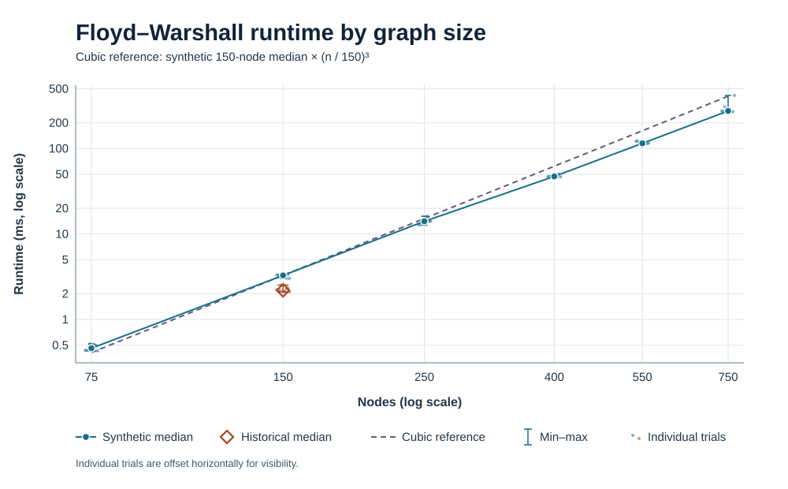

# Evaluación de APSP-Flights

El estudio fijo de 150 aeropuertos usa el grafo predeterminado, con 6,552 aristas dirigidas. Floyd–Warshall coincidió con una implementación independiente de Dijkstra en los 22,500 pares ordenados, incluidas las consultas de un aeropuerto a sí mismo. Todos los pares de aeropuertos distintos eran alcanzables. Cada eliminación individual conservó la conectividad entre los aeropuertos restantes, aunque retirar PEK alargó 1,345 rutas. La mayor distancia de camino mínimo fue de **20,093.22 km**, entre BOG y CGK en ambas direcciones.

## Datos y grafo

La evaluación utiliza los archivos incluidos `dataset/datos_aeropuertos_validacion.dat` (7,698 filas) y `dataset/datos_rutas_validacion.dat` (67,663 filas) y los 150 códigos IATA fijos de `dataset/aeropuertos_demo.txt`, en el orden del archivo. El repositorio registra una descarga del 20 de octubre de 2026. Según OpenFlights, su proveedor dejó de actualizar los datos de rutas en junio de 2014. Las sumas de verificación, la atribución y las referencias a las licencias acompañan los datos. [Notas sobre los datos en el repositorio](../dataset/README.md) · [Documentación de los datos de OpenFlights](https://openflights.org/data.php)

El lector conserva aeropuertos con códigos IATA, identificadores y coordenadas válidos. Incluye filas de vuelos sin escalas cuando ambos identificadores pertenecen a la selección, descarta bucles y elimina conexiones dirigidas duplicadas. Pondera las aristas con la distancia de círculo máximo en kilómetros, calculada con la fórmula de Haversine y un radio terrestre de 6,371 km. La selección comienza con MEX y NRT y completa los otros 148 lugares según la suma de los grados de entrada y salida en la red de origen, con desempate por identificador de aeropuerto de OpenFlights. Esta regla favorece a los aeropuertos más conectados. Exigir que ambos extremos estén seleccionados también excluye cualquier camino que pase por un aeropuerto ajeno a la lista. [Método de selección](../README.md#que-150-aeropuertos-estamos-usando)

| Métrica | Resultado |
| --- | ---: |
| Aeropuertos | 150 |
| Aristas dirigidas | 6,552 |
| Densidad dirigida, `6,552 / (150 × 149)` | 29.32% |
| Aristas dirigidas sin arista inversa | 30 |
| Sumas de los grados de entrada y de salida | 6,552 cada una |
| Promedios de los grados de entrada y de salida | 43.68 cada uno |
| Mayor grado de entrada | AMS, 110 |
| Mayor grado de salida | FRA, 110 |
| Componentes fuertemente conexas | 1 (150 aeropuertos) |
| Pares ordenados alcanzables / inalcanzables, excluidos los pares de un aeropuerto consigo mismo | 22,350 / 0 |
| Etiquetas de país o territorio de OpenFlights | 54 |

Las cuatro etiquetas más representadas fueron Estados Unidos (28), China (14), Reino Unido (10) y España (9). Las latitudes abarcaron de 33.95° S (SYD) a 60.32° N (HEL), y las longitudes de 123.18° O (YVR) a 151.18° E (SYD). Las componentes fuertemente conexas se calcularon agrupando los vértices mutuamente alcanzables en la matriz de Floyd–Warshall. [Totales del grafo](artifacts/graph_summary.csv) · [Grados y coordenadas](artifacts/airport_degrees.csv) · [Tamaños de las componentes](artifacts/components.csv)

## Corrección de los caminos mínimos

La prueba de integración en Python ejecutó Dijkstra con una cola de prioridad desde cada origen, usando las aristas dirigidas que exporta la aplicación. Comparó la alcanzabilidad y la distancia con el programa en C++ para cada destino y verificó los extremos, los tramos dirigidos y la suma de los pesos de cada camino reconstruido. Se aplicó una tolerancia absoluta de `1e-6 km` por la aritmética de punto flotante y la serialización JSON con 12 cifras significativas. Todas las comparaciones pasaron. Las 150 consultas de la diagonal devolvieron exactamente cero y un solo aeropuerto. La prueba con dos aeropuertos comprueba que MEX → NRT es inalcanzable y que el sentido inverso es alcanzable. Las pruebas también comprueban distancias asimétricas en el grafo predeterminado.

La prueba de empates en C++ verifica que una arista directa se conserva ante una alternativa de igual costo y que, entre caminos de igual costo, se conserva el primero encontrado en el orden de los vértices. El algoritmo sustituye un predecesor solo cuando hay una mejora estricta. El constructor inicializa dos matrices de `V × V`, procesa `E` aristas y ejecuta `V³` relajaciones. Su tiempo es `Θ(V³ + E)` y su espacio auxiliar es `Θ(V²)`. Una consulta de distancia cuesta `Θ(1)` y reconstruir un camino finito toma tiempo proporcional a su número de aeropuertos. La comparación independiente se realiza sobre el grafo cargado. La misma prueba en Python recalcula los pesos de Haversine a partir de las coordenadas exportadas.

## Eliminación de un aeropuerto

Para cada aeropuerto, el análisis eliminó el vértice y sus aristas incidentes, conservó el orden relativo de los vértices restantes y volvió a ejecutar el mismo constructor de Floyd–Warshall. Comparó pares dirigidos de aeropuertos distintos cuyos dos extremos permanecían en el grafo. La proporción de pérdida divide los pares que se volvieron inalcanzables entre los que eran alcanzables antes de la eliminación. El CSV ordena por número de pérdidas descendente, con desempate por código IATA ascendente. Entre los pares que siguieron siendo alcanzables, un aumento mayor que `1e-6 km` cuenta como desvío. La proporción de desvíos divide ese total entre el número de pares que siguieron siendo alcanzables. El aumento promedio y máximo se calcula solo para los pares cuya distancia aumentó. Las proporciones con denominador cero y las magnitudes de desvío sin aumentos quedan en blanco.

Las 150 eliminaciones empataron con **0 pérdidas de 22,052** pares supervivientes previamente alcanzables. Hubo desvíos medibles en 137 escenarios. PEK registró el mayor número de desvíos, con **1,345 pares afectados (6.10%)** y un aumento promedio de 390.25 km entre esos pares. GRU registró el mayor aumento individual, **5,052.53 km**, y afectó a 14 pares. Una prueba dirigida comprueba la pérdida de alcanzabilidad y los aumentos de distancia, y una prueba con un grafo disperso cubre un conjunto de comparación vacío. [Resultados de las 150 eliminaciones](artifacts/airport_removal.csv)

## Caminos mínimos más largos

La tabla muestra las diez mayores distancias finitas entre aeropuertos distintos. Se ordenan de mayor a menor usando la distancia con precisión completa, con desempate exacto por código IATA de origen y luego de destino, ambos en orden ascendente. Cada distancia mostrada suma los pesos de la ruta reconstruida. La primera fila es el máximo entre los pares dirigidos alcanzables.

| Posición | Secuencia de aeropuertos | Distancia (km) | Tramos |
| ---: | --- | ---: | ---: |
| 1 | BOG → IAH → NRT → CGK | 20,093.22 | 3 |
| 2 | CGK → NRT → IAH → BOG | 20,093.22 | 3 |
| 3 | BOG → FRA → SIN | 19,366.36 | 2 |
| 4 | SIN → FRA → BOG | 19,366.36 | 2 |
| 5 | CGK → NRT → IAH → PTY | 19,364.73 | 3 |
| 6 | PTY → IAH → NRT → CGK | 19,364.73 | 3 |
| 7 | SYD → AUH → CMN → LPA → TFS | 19,190.67 | 4 |
| 8 | TFS → LPA → CMN → AUH → SYD | 19,190.67 | 4 |
| 9 | BOG → FRA → KUL | 19,084.62 | 2 |
| 10 | KUL → FRA → BOG | 19,084.62 | 2 |

La arista directa más larga fue **SYD → DFW, 13,808.18 km**, con el mismo criterio de desempate por extremos. [Clasificación de caminos](artifacts/longest_shortest_paths.csv) · [Arista directa más larga](artifacts/longest_direct_edge.csv)

## Experimento de tiempo de ejecución

Se midieron el grafo histórico de 150 nodos y un grafo sintético determinista por tamaño. Cada grafo sintético contiene una muestra uniforme sin reemplazo de `round(0.29315436241610737 × V(V−1))` aristas dirigidas distintas, sin bucles. Se recorren los pares ordenados en orden de vértice y se muestrea con MT19937, con semilla `20261124 + V` y muestreo por rechazo para los sorteos acotados. A cada arista seleccionada se le asigna un peso entero uniforme de 1 a 10,000 km sintéticos. La densidad histórica coincide salvo por el redondeo a un entero. Los pesos y la topología sintéticos carecen de restricciones geográficas.

Las mediciones se ejecutaron secuencialmente el 24 de noviembre de 2026, tras finalizar las tareas paralelas de evaluación. El equipo tenía un Intel Core i7-1255U con 12 procesadores lógicos visibles para el proceso y ejecutaba Windows x64, compilación 26300.10075. La compilación C++17 usó GCC 15.2.0 (MinGW-w64/UCRT), CMake 4.3.1 y Ninja 1.13.2, en modo `Release` con `-O3 -DNDEBUG`. Para cada grafo se hicieron dos calentamientos sin medir y nueve ensayos medidos. Un reloj monótono `std::chrono::steady_clock` midió solo el constructor de Floyd–Warshall, incluida la asignación e inicialización de las matrices de distancias y predecesores, la inserción de aristas directas y la relajación. La preparación del grafo, la suma de verificación de los resultados, la destrucción del objeto, la escritura de archivos y la generación de la gráfica quedaron fuera del intervalo medido.

| Grafo | Nodos | Aristas | Mediana (ms) | Mín.–máx. (ms) | Desv. estándar muestral (ms) |
| --- | ---: | ---: | ---: | ---: | ---: |
| Sintético | 75 | 1,627 | 0.461 | 0.428–0.518 | 0.035 |
| Histórico | 150 | 6,552 | 2.192 | 2.105–2.525 | 0.138 |
| Sintético | 150 | 6,552 | 3.279 | 3.024–3.338 | 0.138 |
| Sintético | 250 | 18,249 | 14.080 | 12.679–16.169 | 1.006 |
| Sintético | 400 | 46,787 | 47.248 | 46.234–50.497 | 1.260 |
| Sintético | 550 | 88,518 | 115.137 | 113.738–122.362 | 3.315 |
| Sintético | 750 | 164,679 | 275.461 | 268.372–418.651 | 47.998 |



La referencia cúbica es `3.2792 ms × (V / 150)³`, normalizada con la mediana del grafo sintético de 150 nodos. La mediana sintética medida aumentó unas 598 veces al multiplicar por diez el número de nodos, de 75 a 750. La referencia aumenta 1,000 veces en el mismo intervalo. El algoritmo ejecuta `V³` relajaciones y el tiempo transcurrido también depende de la instancia del grafo, el comportamiento de la memoria y el procesador y la carga del sistema. Las dos instancias de 150 nodos tenían el mismo número de aristas y distintas medianas. Los nueve ensayos de 750 nodos presentaron la mayor dispersión. Estos tiempos corresponden a un equipo, una compilación y una instancia por tamaño. [Ensayos](artifacts/benchmark_trials.csv) · [Resúmenes con medias y desviaciones estándar muestrales](artifacts/benchmark_summary.csv)

## Reproducción

Ejecuta los comandos desde la raíz del repositorio con un compilador C++17, CMake 3.20+, Ninja y Python 3.10+. La evaluación y la gráfica no requieren paquetes adicionales de Python. Los comandos usan PowerShell con MinGW. En Linux, usa `./build/bin/apsp_analysis`, `./build/bin/apsp_benchmark` y `python3`.

```powershell
cmake -S . -B build -G Ninja -DCMAKE_BUILD_TYPE=Release
cmake --build build
ctest --test-dir build --output-on-failure
py -3 -m unittest discover -s test -p 'test_*.py' -v
py -3 scripts/demo.py --headless --from MEX --to NRT
.\build\bin\apsp_analysis.exe build/evaluation-run
.\build\bin\apsp_benchmark.exe build/evaluation-run
py -3 evaluation/plot_runtime.py build/evaluation-run
```

En la verificación original en Windows pasaron las dos pruebas de CTest y las diez pruebas de Python. La comprobación sin interfaz gráfica devolvió MEX → LAX → NRT a 11,253.82 km mediante Python y el iniciador de Windows. También pasó la comprobación opcional de Tkinter `py -3 scripts/demo.py --gui-smoke`. En ese equipo se reprodujeron, byte por byte, los seis CSV del grafo a partir de los datos incluidos. Al pasar a `plot_runtime.py` los CSV de tiempos publicados se reprodujo el SVG byte por byte. Una ejecución nueva del benchmark vuelve a medir los tiempos. Las bibliotecas matemáticas pueden dar distancias geográficas que difieran en los últimos dígitos y esas diferencias pueden cambiar el orden de distancias casi iguales.

Las rutas describen un grafo inducido histórico con énfasis en aeropuertos muy conectados. El modelo no abarca horarios, frecuencia, capacidad, demanda, trayectorias reales ni viabilidad comercial. El experimento de eliminación retira un aeropuerto a la vez en ese grafo. La resiliencia de los servicios actuales y los resultados de otras selecciones quedan fuera del estudio.
